# Sécurité des agents IA - Harness sandboxing

**Prérequis**: 

* Connaissance de [DeepAgents](https://github.com/langchain-ai/deepagents)
* Connaissance du fonctionnement d'une machine virtuelle
* Connaissance de [microsandbox](https://github.com/superradcompany/microsandbox) (Get started du SDK Python)

## Imaginez le scénario suivant…

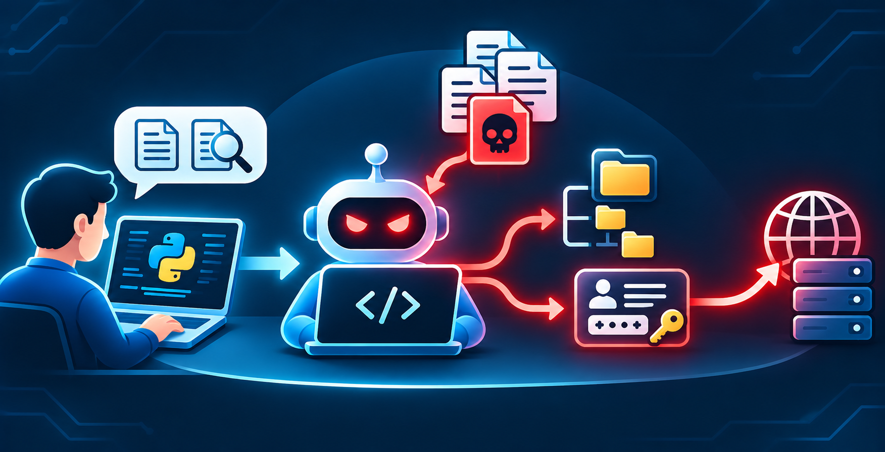

Vous demandez à un agent IA de développer un script Python pour analyser des fichiers présents sur votre machine.

L'agent commence son travail et génère le code nécessaire. Mais une instruction malveillante, dissimulée dans l'un des fichiers analysés, influence son comportement.

Il tente alors d'accéder à des répertoires qui ne font pas partie de sa mission, récupère des informations sensibles et cherche à les transmettre vers un serveur externe.

Le problème ? L'agent dispose des permissions et des accès de son environnement d'exécution. Ses actions pourraient donc avoir des conséquences bien au-delà de la tâche initialement demandée.

**Comment empêcher un agent IA de compromettre le système qui l'héberge, alors même qu'il doit pouvoir exécuter du code et utiliser des outils de manière autonome ?**

C'est précisément pour répondre à ce problème qu'intervient **le sandboxing**.

## Qu'est-ce que le sandboxing ?

Le ***sandboxing*** (ou bac à sable) est un mécanisme d'isolation permettant d'exécuter du code, des commandes ou des actions dans un environnement contrôlé, séparé du système hôte.

Dans le contexte d'un agent IA, il permet de lui fournir un environnement d'exécution dédié, dans lequel ses opérations sont limitées aux ressources et aux permissions qui lui sont accordées.

## Pourquoi utiliser le sandboxing ?

Un agent IA peut interpréter des instructions, prendre des décisions et exécuter des actions de manière autonome. Cette capacité d'action introduit des risques lorsqu'il interagit directement avec un système informatique.

Par exemple, un agent peut générer du code incorrect, interpréter des instructions malveillantes ou effectuer des opérations inattendues. Il est donc nécessaire de **définir une frontière technique entre l'agent et le système hôte**.

Le *sandboxing* répond à cet objectif central : **réduire la surface d'exposition du système face aux actions autonomes d'un agent IA et contenir les conséquences de ses opérations**.

| Risques                                                       | Objectifs de sécurité                                                                                      |
| ------------------------------------------------------------- | ---------------------------------------------------------------------------------------------------------- |
| Modification ou suppression de fichiers système               | **Intégrité** : protéger le système et les données contre les modifications non autorisées.                |
| Accès à des données sensibles ou des secrets                  | **Confidentialité** : empêcher l'accès et la divulgation de données sensibles.                             |
| Boucles infinies et consommation excessive de ressources      | **Disponibilité** : éviter qu'un agent monopolise ou dégrade les ressources du système.                    |
| Erreurs, comportements inattendus ou compromission de l'agent | **Confinement** : limiter les conséquences d'un incident à l'environnement isolé.                          |
| Prompt injection et instructions malveillantes                | **Confinement** : limiter les conséquences d'une manipulation de l'agent.                                  |
| Connexions réseau non autorisées                              | **Maîtrise des interactions** : contrôler les accès aux ressources et les communications avec l'extérieur. |
| Effets de bord entre plusieurs exécutions                     | **Isolation** : garantir un environnement propre et indépendant pour chaque exécution.                     |

> [!IMPORTANT]
> Le *sandboxing* **ne garantit pas qu'un agent ne produira jamais d'action malveillante ou incorrecte**. Il permet surtout de limiter les conséquences de ses actions en imposant une frontière de sécurité entre son environnement d'exécution et le système hôte.

### Que doit isoler une sandbox ?

Une *sandbox* doit contrôler et isoler les différentes ressources du système afin de limiter les accès et les actions possibles de l'environnement d'exécution.

#### Modèle de confiance et frontière de sécurité

Pour éviter qu'une compromission de l'agent ne se propage au système hôte, il est essentiel de définir des frontières de sécurité strictes et d'imposer des contrôles à chaque niveau.

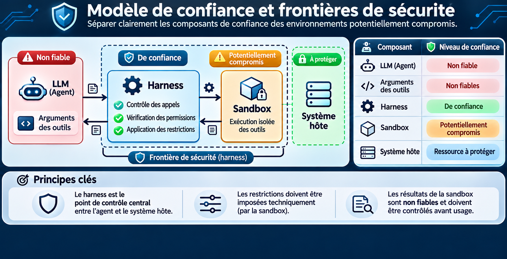

#### Sandbox et *filesystem*

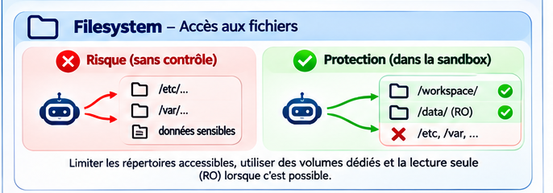

Le système de fichiers constitue une surface d'exposition importante pour un agent IA. Sans restrictions, celui-ci peut accéder à des fichiers sensibles ou modifier des ressources du système hôte.

La *sandbox* permet de restreindre cet accès aux seuls répertoires nécessaires, grâce à des mécanismes tels que les Mount Namespaces, les volumes dédiés ou les montages en lecture seule.

> [!WARNING]
> L'isolation n'empêche pas un agent de modifier ou supprimer les fichiers auxquels il dispose d'un accès en écriture. Par exemple, une *sandbox* peut empêcher la modification de `/etc/passwd`, sans pour autant empêcher la suppression d'un fichier important situé dans un répertoire auquel l'agent a accès. **La sécurité dépend donc aussi des permissions accordées à l'environnement**.

#### Sandbox et réseau

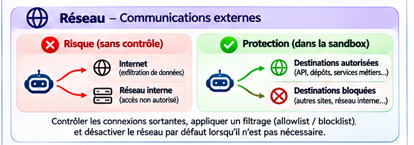

Une *sandbox* peut être isolée du système hôte tout en **conservant un accès à Internet**. L'isolation du système de fichiers ne garantit donc pas celle des communications réseau.

Un agent peut exploiter cet accès pour transmettre des données accessibles dans son environnement vers un serveur externe, notamment des fichiers ou des secrets.

Il est donc essentiel **de contrôler les connexions sortantes** afin de prévenir les communications non autorisées.

Il est recommandé **de désactiver le réseau par défaut** lorsqu'il n'est pas nécessaire, puis **d'autoriser uniquement les destinations indispensables à l'exécution** (*Allowlist*).

#### Sandbox et exposition des secrets

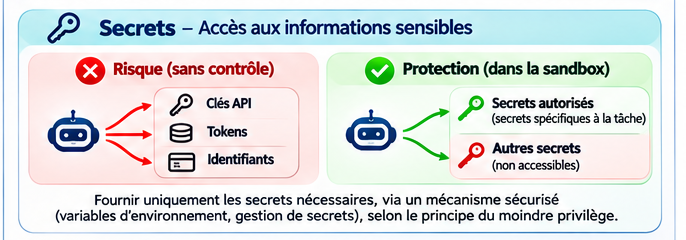

L'environnement d'exécution d'une *sandbox* reste comparable à un système informatique classique : il peut être ciblé par des attaques telles que l'exécution de code malveillant ou l'exploitation de vulnérabilités.

Un code compromis peut ainsi tenter de récupérer les informations sensibles accessibles depuis cet environnement, notamment les variables d'environnement, les clés API, les tokens d'accès et les identifiants. **L'isolation de la sandbox ne protège donc pas les secrets qui lui sont accessibles**.

Lorsque cela est possible, les secrets doivent être fournis au moyen de mécanismes contrôlés, avec des permissions limitées et une durée de validité réduite.

#### En résumé

L'objectif du *sandboxing* est ainsi:

| Dimension             | Objectif                                                                  | Mécanismes / exemples techniques                                                                                             |
| --------------------- | ------------------------------------------------------------------------- | ---------------------------------------------------------------------------------------------------------------------------- |
| **Filesystem**        | Empêcher l'accès aux fichiers sensibles et limiter les modifications.     | Restrictions de montage, volumes autorisés, systèmes de fichiers en lecture seule.                                           |
| **Processus**         | Isoler les processus et limiter leur création.                            | Isolation des PID (Namespaces), limitation du nombre de processus.                                                           |
| **Réseau**            | Contrôler les connexions entrantes et sortantes.                          | Filtrage des connexions réseau, règles d'autorisation et de blocage, restrictions des destinations accessibles.              |
| **CPU / RAM**         | Limiter la consommation des ressources système.                           | Quotas CPU, limites mémoire, Cgroups, prévention des abus de ressources.                                                     |
| **Permissions**       | Restreindre les privilèges et les actions autorisées.                     | Utilisateur non privilégié, Linux Capabilities, principe du moindre privilège.                                               |
| **Environnement**     | Protéger les variables d'environnement, clés API et secrets.              | Contrôle des variables d'environnement, limitation de l'exposition des secrets, gestion des credentials.                     |
| **Durée d'exécution** | Éviter les traitements interminables.                                     | Timeout, durée maximale d'exécution, arrêt forcé des processus.                                                              |
| **Isolation globale** | Empêcher une compromission de l'environnement d'affecter le système hôte. | Frontière d'isolation, séparation hôte / environnement isolé, combinaison de mécanismes de sécurité (défense en profondeur). |

## Comment fonctionne le sandboxing dans le harness d'un agent IA ?

Le *sandboxing* intervient généralement au niveau de l'exécution des outils de l'agent.

L'agent ne communique pas directement avec le système hôte : il passe par le harness, qui contrôle les appels aux outils, vérifie les permissions et délègue leur exécution à un environnement isolé. **Les restrictions doivent être imposées techniquement pendant toute l'exécution, et non simplement vérifiées avant le lancement de l'outil**.

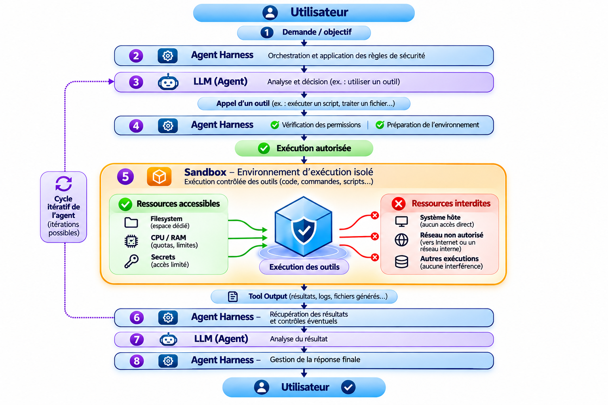

### Les principales technologies de sandboxing

Plusieurs approches permettent d'isoler l'environnement d'exécution d'un agent IA. Parmi les principales :

|         Approche          | Principe                                                                                                                                |   Technologies <br> (liste non exhaustive)   |
| :-----------------------: | --------------------------------------------------------------------------------------------------------------------------------------- | :------------------------------------------: |
|   **Conteneurisation**    | Isole les processus dans des environnements utilisant le noyau de l'hôte, avec des systèmes de fichiers et des espaces de noms séparés. |          Docker, Podman, containerd          |
|    **Virtualisation**     | Exécute les tâches dans des machines virtuelles légères disposant d'un noyau distinct, avec une isolation via l'hyperviseur.            | Firecracker, Cloud Hypervisor, microsandbox  |
|  **Sandboxing système**   | Restreint les capacités des processus à l'aide de mécanismes de sécurité du système d'exploitation.                                     | Linux Namespaces, cgroups, seccomp, AppArmor |
| **Sandboxing applicatif** | Limite les capacités d'exécution au niveau du runtime ou de l'environnement applicatif.                                                 |     WebAssembly (WASM), Wasmtime, Wasmer     |

<br>

Ces approches reposent sur des frontières de sécurité différentes et ne présentent donc pas les mêmes garanties.

* **Isolation au niveau du système d'exploitation** : les environnements partagent le noyau de l'hôte. Une vulnérabilité de celui-ci peut compromettre l'ensemble des environnements isolés. .

* **Isolation au niveau de la virtualisation** : chaque machine virtuelle dispose de son propre noyau. La sécurité repose alors sur l'hyperviseur et son isolation vis-à-vis de l'hôte.

* **Isolation au niveau du runtime applicatif** : les capacités du code sont limitées par le runtime et les interfaces auxquelles il donne accès. La sécurité dépend donc de la robustesse de ce dernier.

| Critère                   | Conteneur     | MicroVM          | WASM                 |
| ------------------------- | ------------- | ---------------- | -------------------- |
| **Noyau distinct**        | Non           | Oui              | Pas nécessairement   |
| **Isolation**             | Noyau partagé | Hyperviseur      | Runtime              |
| **Compatibilité système** | Élevée        | Élevée           | Dépend du runtime    |
| **Performance**           | Très bonne    | Bonne            | Très bonne           |
| **Surface d'attaque**     | Noyau partagé | Hyperviseur + VM | Runtime + interfaces |

> [!TIP]
> Ces approches peuvent être **combinées dans une stratégie de défense en profondeur**. Par exemple, un conteneur peut être renforcé par des mécanismes de sandboxing système, tandis qu'une MicroVM peut fournir une frontière d'isolation supplémentaire grâce à la virtualisation matérielle.
> 
> Néanmoins, cela complexifie l'architecture et peut poser des difficultés de maintien en condition opérationnelle. **Le choix de la sandbox dépend donc des impératifs de sécurité appliqués à l'agent IA**.

L'environnement d'exécution isolé peut être hébergé localement ou sur une infrastructure distante, indépendamment de l'emplacement du LLM.

### Cycle de vie de la sandbox

Le harness doit contrôler l'ensemble du cycle de vie de la sandbox, de sa création à sa destruction, afin de garantir un environnement d'exécution isolé, maîtrisé et éphémère.

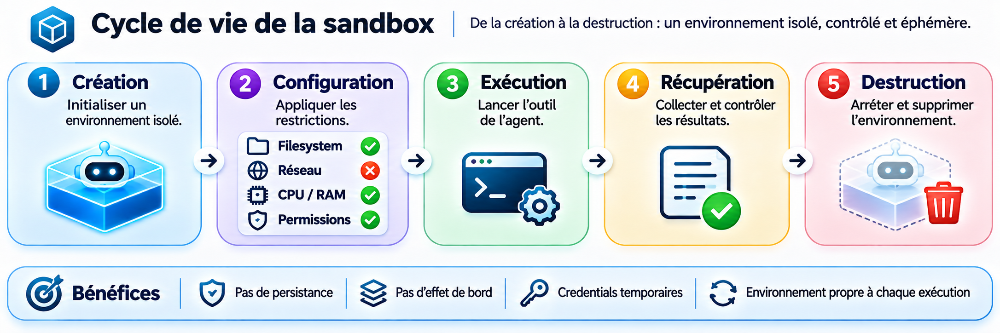

## Les limites du sandboxing

Malgré son rôle essentiel dans la sécurisation des agents IA, le sandboxing présente **certaines limites** qu'il est important de prendre en compte.

### Les principales limites

| Limite                      | Description                                                                                                                         |
| --------------------------- | ----------------------------------------------------------------------------------------------------------------------------------- |
| **Actions autorisées**      | L'agent peut effectuer des opérations destructrices sur les ressources auxquelles il dispose légitimement d'un accès.               |
| **Protection des secrets**  | Les credentials accessibles depuis la sandbox restent exposés à une compromission interne.                                          |
| **Exfiltration de données** | Les données accessibles peuvent être transmises à l'extérieur si les communications réseau sont autorisées.                         |
| **Évasion de sandbox**      | Une vulnérabilité du noyau, de l'hyperviseur ou du runtime peut compromettre l'isolation. **Tout confinement n'est jamais absolu**. |
| **Manipulation de l'agent** | Le sandboxing ne protège pas directement contre la manipulation des décisions de l'agent.                                           |

### Une sécurité multicouche: la défense en profondeur

La sécurité d'un agent IA ne peut pas reposer uniquement sur l'isolation fournie par une *sandbox*. Celle-ci constitue une première couche de protection qui doit être complétée par plusieurs mécanismes indépendants et complémentaires.

Cette stratégie de **défense en profondeur** repose notamment sur :
* **Moindre privilège** : limiter les permissions de l'agent aux ressources strictement nécessaires.
* **Gestion des secrets** : contrôler l'accès aux credentials et limiter leur exposition.
* **Filtrage réseau** : restreindre les communications externes.
* **Validation humaine** : soumettre les opérations sensibles à une confirmation.
* **Surveillance** : journaliser les opérations et détecter les comportements anormaux.

> [!IMPORTANT]
> **Le *sandboxing* ne rend pas un agent IA fiable ou inoffensif**. Il permet principalement de contenir les conséquences de ses actions et doit être associé à d'autres mécanismes de sécurité.

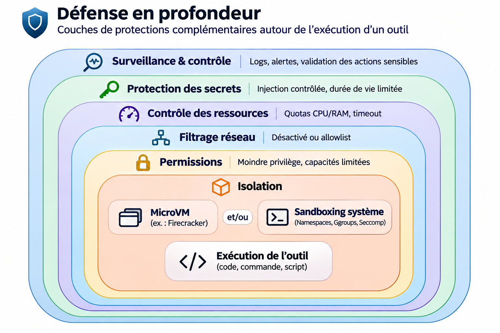

## Bonnes pratiques du sandboxing

La mise en place d'une *sandbox* doit s'accompagner de mesures concrètes visant à renforcer l'isolation, contrôler les accès et maîtriser les conditions d'exécution de l'agent.

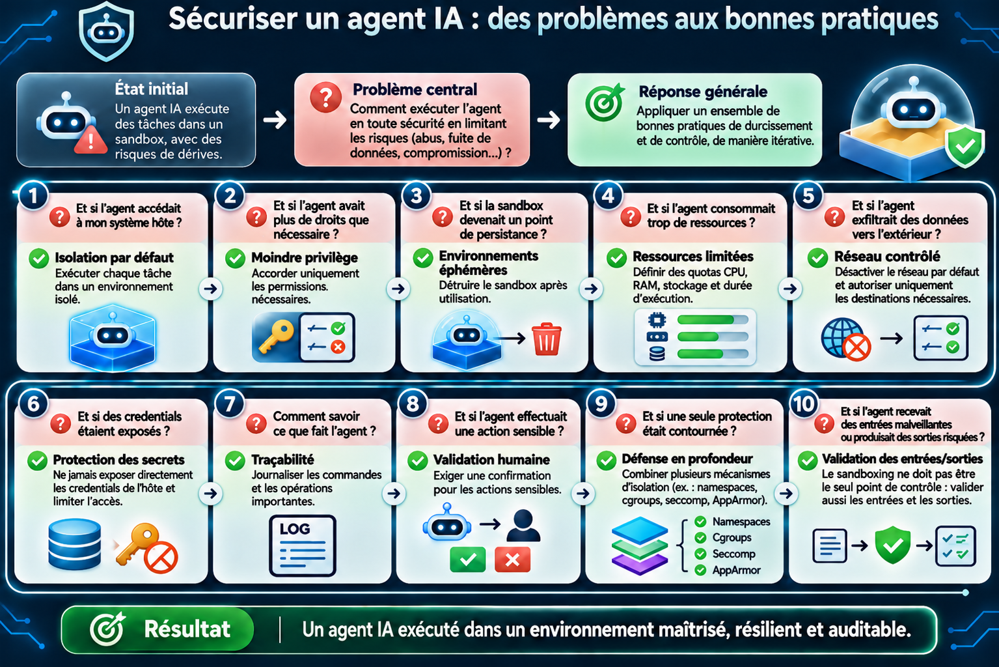

## Mise en application

Maintenant que les principes fondamentaux du sandboxing et son intégration dans l'architecture d'un agent IA sont présentés, nous allons étudier une implémentation concrète à l'aide de `microsandbox`.

### Installation des dépendances

Cet exemple utilise `langfuse` et un modèle `Google`. Il nécessite donc de disposer d'une installation d'un serveur local `langfuse` et d'une clé api Google.

L'installation de `langfuse` est décrite [ici](https://langfuse.com/self-hosting/deployment/docker-compose).

L'utilisation de `microsandbox` repose sur une implémentation communautaire. Pour plus de détails, voir [ici](https://github.com/dod-ia/langchain-backend-microsandbox).

### Installation des paquets

```bash
cd de-ag-sai-001
uv sync
```

### Configuration des variables d'environnement

Créer un .env avec les variables suivantes:

```text
LANGFUSE_SECRET_KEY=
LANGFUSE_PUBLIC_KEY=
LANGFUSE_BASE_URL="http://localhost:3000"

GOOGLE_API_KEY=
```

Si vous voulez utiliser un autre provider de modèles, vous devez modifier la déclaration du modèle dans `agent_sandbox.py`. La déclaration est faite par `model = init_chat_model("google_genai:gemma-4-26b-a4b-it")`.

### Exécution

`uv run src/agent_sandbox`

### Scénario

Le scénario consiste à demande à un agent IA d'exécuter le script `python_test.py`, de copier le résultat dans un fichier et de retourner la réponse obtenue.

Le script `python_test.py` réalise une requête `GET` à l'adresse `https://httpbin.org/headers`. Ce *endpoint* retourne la requête reçue comme réponse. Il permet ainsi d'étudier les requêtes envoyées.

A travers ce scénario, nous illustrerons les bonnes pratiques qu'un *harness* doit suivre pour une bonne utilisation d'une *sandbox*.

### Résultats

Après exécution de `agent_sandbox.py`, observons la trace d'exécution dans `langfuse`. Nous obtenons:

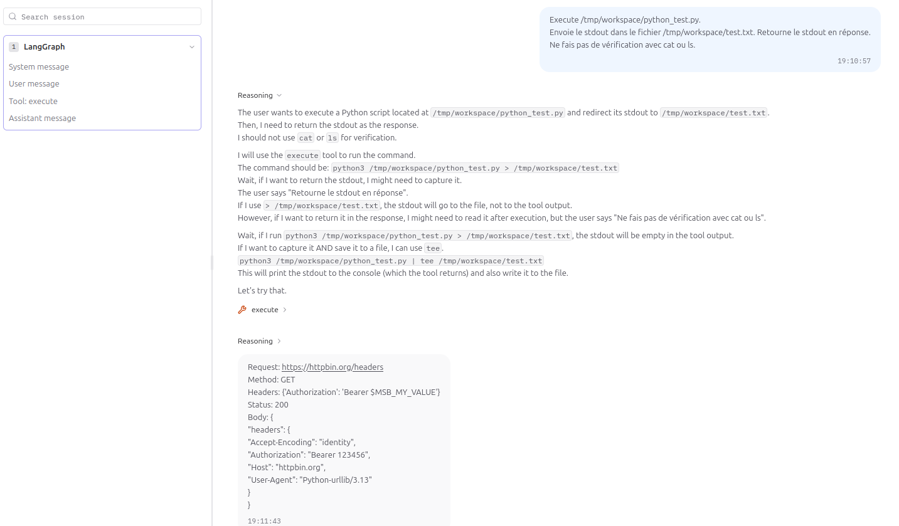
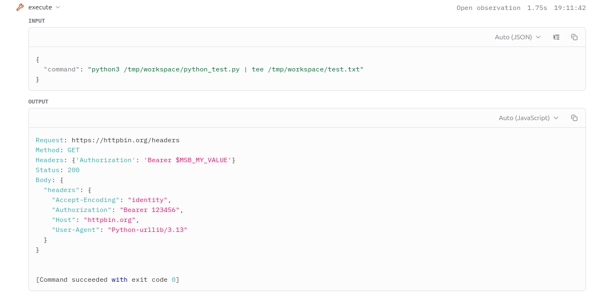

Nous observons que le modèle a utilisé le tool `execute` pour exécuter une commande *bash* arbitraire (`python3 /tmp/workspace/python_test.py | tee /tmp/workspace/test.txt`). Mais les actions ont-elles été réalisées dans la *sandbox* ?

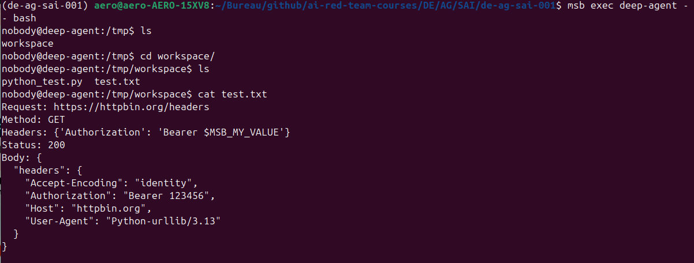

En observant les fichiers présents dans la *sandbox*, nous observons notre script initial et le fichier `/tmp/workspace/test.txt` qui correspond à la réponse. L'exécution a donc bien été faite dans la *sandbox*.

Intéressons-nous maintenant à l'implémentation. Les bonnes pratiques ont-elles été respectées ?

**Sécurité de l'environnement d'exécution**

1. **Isolation par défaut**

    ```python
    agent = create_deep_agent(backend=backend, [...])
    ```

    Cette commande permet de d'exécuter chaque commande au sein du *backend* configuré exclusivement

    **Bonne pratique**: Eviter d'exécuter des commandes sur l'hôte

2. **Moindre privilège**

    ```python
    await Sandbox.create(security=SecurityProfile.RESTRICTED, user="nobody", [...])
    ```

    L'exécution au sein de la VM se fait via l'utilisateur `nobody` qui est très restreint en droit. `SecurityProfile.RESTRICTED` durcit l'environnement interne de la VM (limitation de l'élévation dep rivilège, de montage de système de fichiers...)

    **Bonne pratique**: Eviter d'utiliser l'utilisateur `root`

3. **Environnement éphémère**

    ```python
    await Sandbox.create(ephemeral=True, [...])

    try:
         [...]
    finally:
        await sandbox.stop()
    ```

    `ephemeral=True` est une option qui permet de détruire la *sandbox* lors de l'arrêt de la VM réalisée par `sandbox.stop()`.

    La boucle `try/finally` permet de garantir qu'en cas d'erreur, la suppression de la *sandbox* sera réalisée. C'est utile pour éviter les VM *zombies*.

    **Bonne pratique**: Toujours s'assurer de la destruction de la *sandbox*, notamment lors d'évènements imprévus.

4. **Ressources limitées**

    ```python
    await Sandbox.create(memory=1024, cpus=2,, [...])

    backend = await MicrosandboxSandbox.create(sandbox, timeout=1800,)
    ```

    Ces options permettent de limiter l'usage de la RAM, du CPU et de limiter la durée d'une commande afin de ne pas bloquer l'agent et de protéger les ressources de l'hôte.

    **Bonne pratique**: Toujours limiter les ressources mises à disposition à l'agent afin de protéger la disponibilité de l'hôte. Ne jamais sacrifier les ressources de l'hôte au profit de l'agent.

5. **Réseau contrôlé**

    ```python
    policy = NetworkPolicy(
        default_egress=Action.DENY,
        default_ingress=Action.DENY,
        rules=(
            *Rule.allow_dns(),
            Rule.allow(
                destination="httpbin.org",
                protocol=Protocol.TCP,
                port=443,
            ),
        ),
    )

    network = Network(policy=policy)
    sandbox = await Sandbox.create(network=network, [...])
    ```

    Dans le cadre de notre exemple, notre agent doit contacter `httpbin.org` sur le port `443` via `TCP`. Nous réalisons donc une règle réseau qui autorise que des transactions vers ce domaine sur  ce port précis. Ainsi, par défaut, nous bloquons le réseau (via `DENY`) et n'autorisons que les flux nécessaires, c'est-à-dire les requêtes DNS (pour la résolution du domaine) et le domaine-même.

    Cette politique est très restreinte et non utilisable dans un cas réel classique. Il faut adapter les restrictions en fonction des missions de l'agent. Dans le cas d'un agent très généraliste, il peut être difficile de définir les restrictions à l'avance. Cependant, en général, **un agent n'a pas à accepter de flux entrant** car il n'a pas un rôle de serveur.

    **Bonne pratique**: Limiter au strict minimum les autorisations réseaux, notamment les flux entrants. Ne pas hésiter à établir une *blacklist* de domaines connus comme à risque.

6. **Protection des secrets**

    ```python
        sandbox = await Sandbox.create(secrets=[
            Secret.env(
                "MY_VALUE",
                value="123456",
                allow=["httpbin.org"],
            )
        ], [...])
    ```

    Dans notre script `python_test.py`, nous simulons l'ajout d'une clé secrète (*Bearer*) via `headers={"Authorization": f"Bearer {os.environ['MY_VALUE']}"}`.

    **Une *sandbox* est une zone de faible confiance**. Il est donc important de limiter au maximum la présence de secret accessible.

    Observons les résultats de notre requête:

    ```bash
    # Requête réalisée par la sandbox
    Request: https://httpbin.org/headers
    Method: GET
    Headers: {'Authorization': 'Bearer $MSB_MY_VALUE'}

    # Requête reçu par https://httpbin.org/headers
    Status: 200
    Body: {
    "headers": {
    "Accept-Encoding": "identity",
    "Authorization": "Bearer 123456",
    "Host": "httpbin.org",
    "User-Agent": "Python-urllib/3.13"
    }
    }
    ```

    Nous observons que au sein de la VM, la variable d'environnement `MY_VALUE` (obtenue via `os.environ['MY_VALUE']`) retourne `$MSB_MY_VALUE`. Cependant, le serveur distant reçoit bien `123456` qui est sa valeur.

    Cette particularité est au coeur de la protection des secrets par `microsandbox`. La VM ne connait pas le secret. Ce dernier est remplacé par sa valeur lorsque la requête est interceptée par le *runtime* de `microsandbox` avant d'être transférée à sa destination. Cette action se fait en dehors de la *sandbox* donc le secret ne peut être volé à l'intérieur. Cette approche permet de limiter le risque de mauvaise utilisation du secret à l'interieur de la *sandbox* tout en limitant son risque d'exfiltration via des règles de contrôle domaine. 

    Supposons que vous changez le domaine de la requête sans mettre à jour la configuration de la *sandbox*. Vous obtiendrez `stderr: urllib.error.HTTPError: HTTP Error 403: Forbidden`. Pour plus d'informations, allez [ici](https://docs.microsandbox.dev/sandboxes/secrets).

    **Bonne pratique**: N'utilisez que les secrets strictement nécessaires au sein de la *sandbox*. Si possible, utilisez des mécanismes qui permettent d'éviter de copier un secret au sein d'une VM (que ce soit dans l'environnement ou dans un fichier).

7. **Défense en profondeur**

    **Non implémenté**

    Afin de renforcer la sécurité, il est possible de faire du *hardening* sur la VM qui sert de *sandbox*. Cela dépasse le cadre de ce module.

**Sécurité de l'agent et de ses interactions**

8. **Traçabilité**

    La trace `langfuse` permet de suivre le comportement de l'agent et son raisonnement. Il est intéressant de superviser le *runtime* de `microsandbox` afin d'obtenir les logs au sein de la VM et les métriques. Cet exemple n'implémente pas la supervision de `microsandbox`. Cependant, les logs/métriques sont facilement accessibles et peuvent être exploitées par un outil de visualisation comme `Grafana`.

    **Bonne pratique**: Monitorer les logs/métriques avec un dashboard afin de détecter des comportements nuisibles et garder une traçabilité des actions.

9. **Validation humaine**

    **Non implémenté**

    La validation humaine nécessite une capacité de persistance et de reprise d'un environnement. La destruction systématique pose un problème d'architecture. Une solution sera proposée dans un autre module.

10.  **RBAC, ACL et filtrage de contenu**

        **Non implémenté**

        Bien que la *sandbox* soit un élément de sécurité, elle n'est pas infaillible et ne traite pas les problèmes de droits d'accès et permissions (ACL/RBAC). Afin d'augmenter la sécurité, il est fortement conseillé de garantir qu'un utilisateur n'ait accès qu'à des données dont il a la permission. Ce contrôle se fait en amont lors des transferts de fichiers / sélection d'agents réalisés par le *harness*.
        Utiliser l'outil [Casbin](https://github.com/apache/casbin-pycasbin) peut être intéressant.

        De même, l'agent peut réaliser des actions non souhaitées malgré un usage légitie de la *sandbox*. Par exemple, l'envoi de données personnelles sur un serveur distant. Un filtrage du contenu est pertinent pour limiter le risque de fuite de données. L'usage de *guardrails* / DLP est utile pour ce problème.

        > [!WARNING]
        > Cette expérimentation met en évidence **une limite des mécanismes d'injection contrôlée des secrets** : même si leur valeur n'est pas directement accessible depuis la sandbox, elle peut être divulguée indirectement par l'intermédiaire d'un service distant autorisé
        >
        > En effet, le serveur distant retourne les *headers* de la requête HTTP reçue, ce qui nous permet de récupérer le secret en clair dans la réponse.
        >
        > Ainsi, malgré le mécanisme de protection mis en place par `microsandbox`, l'agent peut indirectement accéder à la valeur du secret à travers les données retournées par le service distant.
        >
        > **Cette expérimentation illustre qu'un secret peut être exposé non seulement par un flux sortant, mais également par un flux entrant.**
        >
        > Il est donc nécessaire de contrôler et d'analyser les flux dans les deux directions, afin de limiter les risques d'exposition des informations sensibles.

### Limitations

Dans cet exemple, la *sandbox* est détruite après chaque requête LLM. Cette caractéristique est robuste mais présente un défaut majeur dans le cadre d'un traitement multi-requêtes, notamment via une interaction *Human-in-the-loop*.

Une confirmation humaine via *Human-in-the-loop* stoppe la requête en cours et demande une confirmation humaine reçue via une autre requête. Dans notre architecture, la nouvelle requête va créer une autre *sandbox*, la précédente étant détruite. **Le travail en amont est donc "détruit"**. La reprise du travail par l'agent se fait donc dans un environnement vierge où **la donnée nécessaire peut ne plus être présente, empêchant la poursuite de la tâche**.

Il est donc nécessaire de fournir une solution de **persistance de l'information**. Il existe deux grandes approches: 

* **Conserver la *sandbox*** jusqu'à la suppression du *thread* par l'utilisateur
* **Implémenter un système de transfert de fichiers** à partir d'une base de données. Chaque nouvelle *sandbox* récupérera les fichiers de la précédente.

Ce problème sera traité dans un autre module !