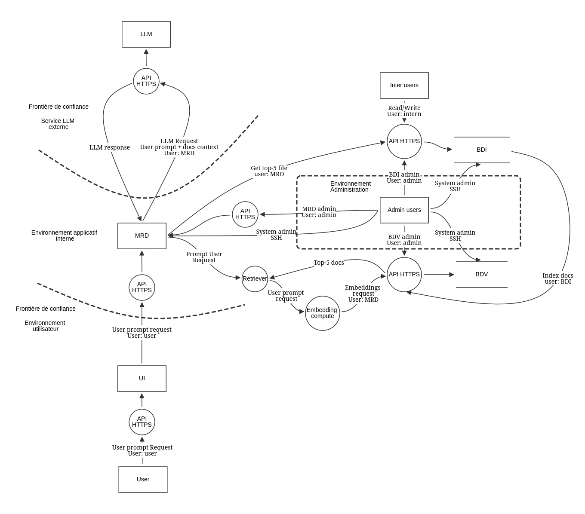

# GO-TM-TMC-002: Threat Model - Mise en application

**Prérequis**: [GO-TM-TMC-001](/GO/GO-TM/GO-TM-TMC/GO-TM-TMC-001/GO-TM-TMC-001.md)

## Cas étudié

Dans ce module, nous allons réaliser un Threat Model afin d'étudier la méthodologie associée à chacune de ses étapes, ainsi que les outils permettant de les mettre en œuvre.

Rappel des étapes d'un Threat Model

| Étape                      | Description                                             |
| -------------------------- | ------------------------------------------------------- |
| **1. Scoping**             | Définir le système et les actifs à protéger.            |
| **2. Modélisation**        | Représenter l'architecture et identifier les menaces.   |
| **3. Analyse des risques** | Évaluer et prioriser les menaces.                       |
| **4. Contre-mesures**      | Définir les protections adaptées.                       |
| **5. Validation et suivi** | Vérifier les protections et maintenir le modèle à jour. |

 

**Sujet**: **Système RAG** (Retrieval-Augmented Generation)

* Un utilisateur peut poser des questions en langage naturel sur une base documentaire interne. Le système récupère les documents pertinents, puis les transmet à un LLM pour générer une réponse contextualisée;
* Des utilisateurs habilités peuvent ajouter/modifier le contenu de la base documentaire interne;
* Le LLM est un service proposé par un fournisseur externe;
* Le système est déployé en local dans l'entreprise;
* Le *RAG* n'est pas impératif à l'activité métier de l'entreprise.
* Les différentes authentifications se font via des *tokens JWS* (si besoin d'aide sur *JWS*, voir [ici](/FO/FO-AUT/FO-AUT-JWT/FO-AUT-JWT-001/FO-AUT-JWT-001.md))

L’objectif est d’identifier les principaux actifs à protéger, les menaces potentielles et les vulnérabilités du système, puis de proposer des mesures de sécurité adaptées.

> [!IMPORTANT]
> Afin de ne pas complexifier (et densifier) inutilement ce module, le cas sera volontairement simplifié. Cependant, **la méthodologie appliquée reste la même dans un cas réel d'audit de sécurité**.

## Étape 1: Définir le système analysé

Afin de réaliser un *Threat Model*, l'étape initiale est de **définir le système à analyser et les actifs à protéger**. Pour la réaliser, il faut répondre à trois questions:

| Nom           | Question                                                                                                                        | Exemple (non exhaustif)                                          |
| ------------- | ------------------------------------------------------------------------------------------------------------------------------- | ---------------------------------------------------------------- |
| **Périmètre** | Quelles composantes sont incluses dans l'analyse ?                                                                              | Utilisateurs,  serveurs, équipe technique, dépendance tierce ... |
| **Actifs**    | Quels actifs présentent une valeur pour un attaquant ou pourraient causer un préjudice à l'entreprise en cas de compromission ? | Documents internes, données sensibles, clés API, serveurs...     |
| **Criticité** | Quel est le niveau de criticité de chaque actif en cas de compromission ?                                                       | ∅                                                                |

Les livrables attendus sont:
  
* Définition du périmètre
* Inventaire des composantes et des actifs
* Matrice de criticité

### Définir le périmètre — « Qu'est-ce qu'on analyse ? »

#### 1. Déterminer les composantes qui constituent le système

Les composantes d'un système peuvent être catégorisées en quatre groupes:

| Type          | Définition                                                                       | Exemple (non exhaustif)                                                                                            |
| ------------- | -------------------------------------------------------------------------------- | ------------------------------------------------------------------------------------------------------------------ |
| **Humain**    | Personnes qui interagissent avec le système ou participent à son exploitation.   | Utilisateurs, administrateurs, équipe technique...                                                                 |
| **Technique** | Composants techniques qui constituent le système et assurent son fonctionnement. | Interface, base de données, LLM, backend...                                                                        |
| **Externe**   | Services, systèmes ou fournisseurs externes avec lesquels le système interagit.  | Fournisseur du LLM, services tiers, systèmes d'authentification.                                                   |
| **Business**  | Processus métier et activités de l'entreprise reposant sur le système.           | Usage opérationnel, consultation de documents internes, recherche de connaissances, assistance aux collaborateurs. |

Application au cas d'usage

| Type          | Ressources                                                                                                                                                                                                                                                                                                   |
| ------------- | ------------------------------------------------------------------------------------------------------------------------------------------------------------------------------------------------------------------------------------------------------------------------------------------------------------ |
| **Humain**    | <ul><li>Utilisateurs internes</li><li>Administrateurs du système</li><li>Équipe informatique et sécurité</li><li>Équipe chargée de la gestion documentaire</li></ul>                                                                                                                                         |
| **Technique** | <ul><li>Base documentaire interne (BDI)</li><li>Base de données vectorielle (BDV)</li><li>Moteur de recherche documentaire (MRD)</li><li>LLM</li><li>Interface utilisateur</li><li>Système d'authentification et de gestion des accès</li><li>Journaux d'activité et de conversations</li></ul>              |
| **Externe**   | <ul><li>Fournisseur du LLM (API externe)</li></ul>                                                                                                                                                                                                                                                           |
| **Business**  | <ul><li>Confidentialité des informations internes</li><li>Fiabilité et exactitude des réponses générées</li><li>Disponibilité du service RAG</li><li>Conformité réglementaire et protection des données</li><li>Continuité des activités métier</li><li>Confiance des utilisateurs dans le système</li></ul> |

#### 2. Identifier les actifs — « Qu'est-ce qu'on veut protéger ? »

Une fois le périmètre déterminé, il est nécessaire **d'identifier les entités de valeurs** (*actifs*) nécessaires à son bon fonctionnement. La nature et le type d'actifs dépendent du système analysé. **Il n'existe donc pas de liste universelle de catégories**. Néanmoins, il est commun d'observer les catégories suivantes:

| Catégorie d'actif              | Exemples                               |
| ------------------------------ | -------------------------------------- |
| **Donnée**                     | Fichiers, informations confidentielles |
| **Interface et communication** | Flux de données applicatifs            |
| **Logiciel**                   | Applications, systèmes                 |
| **Matériel / Infrastructure**  | Serveurs, ordinateurs                  |
| **Accès**                      | Comptes, permissions                   |
| **Métier**                     | Processus critiques, réputation        |

Les composantes peuvent contenir **plusieurs actifs de catégories distinctes**. Il est notamment important de différencier le support (par exemple, un serveur) d'une donnée qu'il héberge.

Application au cas d'usage

| **Composante**                             | **Catégorie d'actif** | **Actif identifié**                                                              |
| ------------------------------------------ | --------------------- | -------------------------------------------------------------------------------- |
| **Base documentaire interne (BDI)**        | Matériel              | Serveur hébergeur local  #1                                                      |
|                                            | Donnée                | Fichiers documentaires bruts                                                     |
|                                            | Accès                 | Comptes utilisateurs internes (lecture/écriture)                                 |
| **Base de données vectorielle (BDV)**      | Matériel              | Serveur hébergeur local #2                                                       |
|                                            | Donnée                | • Fichiers *embeddings*   • journaux d'accès et de modification des données   |
|                                            | Accès                 | Compte administrateur (gestion de la BDV)                                        |
|                                            | Interface             | • API (MRD)   • API (Admin)   • API (BDI)                                  |
| **LLM**                                    | Donnée                | • Requête (Contexte RAG + requête utilisateur)   • Réponse LLM                |
|                                            | Accès                 | Compte MRD                                                                       |
|                                            | Interface             | API (MRD)                                                                        |
| **Moteur de recherche documentaire (MRD)** | Matériel              | Serveur hébergeur local #3                                                       |
|                                            | Donnée                | • Requête/réponse utilisateur   • journaux d'accès/requêtes                   |
|                                            | Accès                 | • Comptes utilisateurs (requêtage)   • compte administrateur (gestion du MRD) |
|                                            | Interface             | • API (Interface utilisateur)   • API (Admin)                                 |
|                                            | Logiciel              | Logiciel applicatif du MRD                                                       |
| **Interface utilisateur**                  | Donnée                | Requête utilisateur                                                              |
|                                            | Accès                 | Comptes utilisateurs                                                             |
|                                            | Logiciel              | Logiciel applicatif de l'interface                                               |
| **Conformité réglementaire**               | Métier                | Actif transversal aux composantes                                                |
| **Continuité du service métier**           | Métier                | Actif transversal aux composantes                                                |

> [!NOTE]
> Cette liste pourrait être plus précise en dissociant les comptes, de leurs droits et du système d'authentification (par exemple, un *token JWS*). Pour des raisons de simplification, nous n'irons pas à ce niveau de profondeur. **Dans un cas réel, il sera cependant nécessaire d'atteindre ce niveau de précision**.

#### 3. Évaluer la valeur des actifs — « Quel serait l'impact d'une compromission ? »

Pour chaque actif, il faut évaluer les conséquences d'une compromission. La compromission peut être évaluée à partir de la **matrice CIA** qui détermine trois critères: **Confidentialité, Intégrité et Disponibilité**.

**Critère du CIA**
| Lettre | Principe            | Définition                                                          | Question pour évaluer la criticité                                                     |
| ------ | ------------------- | ------------------------------------------------------------------- | -------------------------------------------------------------------------------------- |
| **C**  | **Confidentialité** | Empêcher l'accès aux informations par des personnes non autorisées. | Quel serait l'impact si des personnes non autorisées accédaient à ces informations ?   |
| **I**  | **Intégrité**       | Empêcher la modification ou l'altération non autorisée des données. | Quel serait l'impact si les données étaient modifiées ou altérées sans autorisation ?  |
| **A**  | **Disponibilité**   | Garantir que l'actif reste accessible lorsque nécessaire.           | Quel serait l'impact si l'actif devenait inaccessible au moment où il est nécessaire ? |

**Grille d'évaluation du CIA**: 

| Niveau       | Confidentialité (C)                                                                   | Intégrité (I)                                                                    | Disponibilité (A)                                                                   |
| ------------ | ------------------------------------------------------------------------------------- | -------------------------------------------------------------------------------- | ----------------------------------------------------------------------------------- |
| 🟩 **Faible** | Divulgation sans préjudice significatif.                                              | Altération aux conséquences mineures et facilement réversibles.                  | Indisponibilité facilement contournable, sans impact significatif.                  |
| 🟨 **Moyen**  | Divulgation entraînant un préjudice limité ou une exposition d'informations internes. | Altération provoquant des erreurs opérationnelles ou une dégradation du service. | Indisponibilité ralentissant les activités ou nécessitant un contournement.         |
| 🟥 **Élevé**  | Divulgation entraînant un préjudice important, juridique ou réglementaire.            | Altération compromettant la sécurité, la fiabilité ou des processus importants.  | Indisponibilité bloquant une activité critique ou dépassant les délais acceptables. |

Cette étape évalue **la criticité d'un actif**, c'est-à-dire les conséquences d'une compromission (*Impact*). **La probabilité et le niveau de risque seront à examiner dans l'analyse des risques**.

> [!IMPORTANT]
> L'usage du CIA et de cette grille d'évaluation n'est pas standardisé. Chaque entreprise utilise ses propres critères et sa propre grille d'évaluation pour analyser ses actifs. **Cette méthodologie est donnée à titre indicatif**.

> [!TIP]
> On évalue les conséquences de la compromission de l’actif, en tenant compte des droits qu’il permet d’obtenir, et non simplement la nature de l’actif.

**Exemple: Etude de la criticité de l'actif *Serveur hébergeant la BDI***

1. **Confidentialité**: Quel serait l'impact si des personnes non autorisées accédaient au système ?

   Le serveur ne présente pas d'importance particulière. Cependant, il héberge des documents internes critiques. De par sa capacité à donner accès à ces documents, sa confidentialité est du même niveau que les documents qu'il héberge, i.e critique.

    **Note**: 🟥 Élevé

2. **Intégrité**: Quel serait l'impact si le serveur était modifié ou altéré sans autorisation ?

    Si le serveur est altéré, il est possible d'altérer les données qu'il héberge. Des données fausses ou incomplètes peuvent nuire à la qualité des réponses du RAG et de ce fait, induire l'utilisateur en erreur. Ces erreurs peuvent avoir des conséquences sur l'activité de l'entreprise. De ce fait, la criticité de l'intégrité du serveur est élevée.

    **Note**: 🟥 Élevé

3. **Disponibilité**: Quel serait l'impact si le serveur devenait inaccessible au moment où il est nécessaire ?

    Le serveur est nécessaire pour pouvoir alimenter le RAG. Néanmoins, le RAG n'est pas essentiel à l'activité de l'entreprise donc une indisponibilité ne menace pas l'activité bien qu'impactant l'ensemble des utilisateur. Cet impact global implique une criticité moyenne.

    **Note**: 🟨 Moyen

Application au cas d'usage: Matrice de criticité

| Composante | Actif                                               |   C   |   I   |   A   | Justifications                                                                                                                                                                                                                                                                                                           |
| ---------- | --------------------------------------------------- | :---: | :---: | :---: | ------------------------------------------------------------------------------------------------------------------------------------------------------------------------------------------------------------------------------------------------------------------------------------------------------------------------ |
| BDI        | Serveur hébergeant la BDI                           |   🟥   |   🟥   |   🟨   | **C :** sa compromission peut exposer les documents sensibles hébergés. **I :** son altération peut permettre de modifier ou supprimer les documents. **A :** sa panne empêche l'accès aux documents sources, mais le métier peut continuer sans le RAG.                                                                 |
| BDI        | Fichiers documentaires bruts                        |   🟥   |   🟥   |   🟨   | **C :** leur divulgation peut exposer des informations internes sensibles. **I :** leur modification peut entraîner des réponses erronées du RAG. **A :** leur indisponibilité dégrade la recherche documentaire sans arrêter le métier.                                                                                 |
| BDI        | Comptes utilisateurs internes (lecture et écriture) |   🟥   |   🟥   |   🟨   | **C :** leur compromission donne accès aux documents lisibles par le compte. **I :** leurs droits d'écriture peuvent permettre de modifier ou supprimer les documents. **A :** leur compromission ou leur blocage peut perturber la gestion documentaire, sans rendre nécessairement la BDI indisponible.                |
| BDV        | Serveur hébergeant la BDV                           |   🟨   |   🟥   |   🟨   | **C :** sa compromission peut exposer les données vectorielles et des informations techniques. **I :** son altération peut compromettre les données utilisées pour la recherche. **A :** sa panne interrompt la recherche vectorielle, mais le métier peut continuer sans le RAG.                                        |
| BDV        | Fichiers d'embeddings                               |   🟨   |   🟥   |   🟨   | **C :** les vecteurs peuvent révéler certaines informations sur les documents sources mais ils sont difficilement exploitables en l'état. **I :** leur altération peut réduire la pertinence des résultats et induire en erreur l'utilisateur. **A :** leur indisponibilité empêche ou dégrade la recherche vectorielle. |
| BDV        | Journaux d'accès et de modification                 |   🟨   |   🟥   |   🟩   | **C :** les journaux peuvent révéler des activités et accès internes. **I :** leur falsification peut masquer des actions non autorisées. **A :** leur perte gêne les investigations, sans interrompre directement le RAG.                                                                                               |
| BDV        | Compte administrateur de la BDV                     |   🟥   |   🟥   |   🟨   | **C :** ses privilèges peuvent donner accès aux données et à la configuration. **I :** il peut permettre de modifier ou supprimer les embeddings. **A :** sa perte complique l'administration et la restauration du service.                                                                                             |
| BDV        | API (MRD, Admin, BDI)                               |   🟨   |   🟥   |   🟨   | **C :** l'exposition dépend des données accessibles par chaque API et de ses contrôles d'accès. **I :** des opérations non autorisées peuvent modifier les données ou les index. **A :** une panne peut perturber la recherche ou l'administration du RAG.                                                               |
| LLM        | Requête avec contexte RAG et requête utilisateur    |   🟥   |   🟥   |   🟨   | **C :** le contexte transmis au fournisseur peut contenir des extraits confidentiels. **I :** une requête ou un contexte altéré peut orienter le modèle vers une réponse erronée. **A :** l'indisponibilité empêche la génération de réponses, sans arrêter le métier.                                                   |
| LLM        | Réponse du LLM                                      |   🟥   |   🟥   |   🟨   | **C :** la réponse peut divulguer des informations issues des documents internes. **I :** une réponse fausse ou manipulée peut induire l'utilisateur en erreur. **A :** l'absence de réponse rend le RAG inutilisable, mais le métier peut continuer autrement.                                                          |
| LLM        | Compte MRD utilisé pour accéder au LLM              |   🟥   |   🟨   |   🟨   | **C :** sa compromission peut permettre l'utilisation non autorisée du service et l'accès aux données transmises. **I :** ses droits d'accès ne prouvent pas qu'il peut modifier les données sources. **A :** sa désactivation peut interrompre les appels au LLM.                                                       |
| LLM        | API du MRD vers le LLM                              |   🟥   |   🟥   |   🟨   | **C :** elle transmet des requêtes et des contextes potentiellement confidentiels. **I :** une altération des données transmises peut fausser les réponses. **A :** sa panne empêche le MRD d'obtenir des réponses du LLM.                                                                                               |
| MRD        | Serveur hébergeant le MRD                           |   🟨   |   🟥   |   🟨   | **C :** sa compromission peut exposer les configurations et informations techniques. **I :** son altération peut modifier le traitement des requêtes et les contrôles d'accès. **A :** sa panne rend le RAG indisponible, sans bloquer le métier.                                                                        |
| MRD        | Requêtes et réponses utilisateur                    |   🟥   |   🟥   |   🟨   | **C :** elles peuvent contenir des informations personnelles ou confidentielles. **I :** leur modification peut fausser l'information présentée ou conservée. **A :** leur indisponibilité gêne l'utilisation ou la traçabilité du RAG.                                                                                  |
| MRD        | Journaux d'accès et de requêtes                     |   🟨   |   🟥   |   🟩   | **C :** ils peuvent contenir des questions sensibles ou des extraits documentaires. **I :** leur falsification peut masquer une attaque ou fausser une enquête. **A :** leur perte réduit les capacités d'investigation sans nécessairement interrompre le service.                                                      |
| MRD        | Comptes utilisateurs (requêtage uniquement)         |   🟥   |   🟩   |   🟨   | **C :** un utilisateur peut obtenir des informations via ses requêtes si le RAG les lui restitue. **I :** le droit de requêtage seul ne permet pas de modifier les documents sources. **A :** la perte d'un compte empêche son titulaire d'utiliser le RAG, sans affecter les autres utilisateurs.                       |
| MRD        | Compte administrateur du MRD                        |   🟥   |   🟥   |   🟨   | **C :** ses privilèges peuvent donner accès aux données et configurations sensibles. **I :** il peut permettre de modifier l'application ou les contrôles d'accès. **A :** sa perte peut compliquer la maintenance et la restauration.                                                                                   |
| MRD        | API (interface utilisateur, administration)         |   🟥   |   🟥   |   🟨   | **C :** une faille de contrôle d'accès peut exposer des données ou des fonctions d'administration. **I :** des appels non autorisés peuvent modifier les paramètres ou les données. **A :** une panne peut rendre tout ou partie du RAG inutilisable.                                                                    |
| MRD        | Logiciel applicatif du MRD                          |   🟨   |   🟥   |   🟨   | **C :** une faille peut exposer des informations selon les privilèges de l'application. **I :** une modification malveillante peut fausser le traitement des requêtes ou les contrôles d'accès. **A :** sa panne interrompt le RAG, sans bloquer le métier.                                                              |
| UI         | Requête utilisateur saisie dans l'interface         |   🟥   |   🟨   |   🟨   | **C :** la requête peut contenir des informations personnelles ou confidentielles. **I :** sa modification peut changer le sens de la demande et fausser la réponse. **A :** l'indisponibilité de l'interface empêche la saisie des requêtes par ce canal.                                                               |
| UI         | Comptes utilisateurs                                |   🟨   |   🟩   |   🟩   | **C :** la compromission expose les informations accessibles au titulaire selon ses droits. **I :** si le compte ne permet que le requêtage, il ne peut pas modifier les documents sources. **A :** le blocage du compte empêche uniquement son titulaire d'utiliser l'interface.                                        |
| UI         | Logiciel applicatif de l'interface                  |   🟩   |   🟥   |   🟨   | **C :** l'exposition directe reste limitée si l'interface ne stocke pas de données sensibles. **I :** une modification peut détourner les saisies ou afficher de fausses réponses. **A :** une panne empêche l'accès au RAG via cette interface.                                                                         |

| Composante      | Actif                        | Criticité | Justification                                                                                                                                         |
| --------------- | ---------------------------- | :-------: | ----------------------------------------------------------------------------------------------------------------------------------------------------- |
| **Transversal** | Conformité réglementaire     |     🟥     | Une violation des obligations réglementaires peut entraîner des sanctions juridiques et financières, même si le RAG n’est pas essentiel à l’activité. |
| Transversal     | Continuité du service métier |     🟩     | L’indisponibilité du RAG perturbe le service, mais ne bloque pas l’activité principale. Sa disponibilité n'est donc pas critique à l'entreprise.      |

**Remarque :** ces évaluations sont indicatives. Les niveaux dépendent notamment des permissions réelles des comptes, des opérations autorisées par les API et de la sensibilité effective des documents.

> [!WARNING]
> Dans cet exemple, l'évaluation de la valeur des actifs est **arbitraire**. Elle est à faire au  par-cas selon les normes de l'entreprise et du système concerné.
> 

## Étape 2: Modéliser le système étudié

L'objectif de cette étape est de créer un schéma récapitulatif illustrant le système. Ce schéma repose sur les informations obtenues lors de la phase de *Scoping*. L'objectif est de fournir un support pour orienter la réflexion lors de la phase de recherche de menace.

Afin de faire ce schéma, il existe différents outils notamment **Threat Dragon**. C'est un outil open-source gratuit développé par *OWASP*. Il est disponible [ici](https://www.threatdragon.com).

Sur ce schéma, il est important de représenter:

* Les différentes composantes du système
* Les interactions et les connexions entre les composantes
* Les protocoles d'interaction et les droits d'accès
* Les frontières de confiance du système

Le livrable attendu est le **schéma système**.

Application au cas d'usage : Modélisation du système

 

## Étape 3: Déterminer les menaces et les risques

L'**analyse des risques** est une démarche qui consiste à identifier les menaces pesant sur un système et à évaluer les risques associés

### Identification des menaces

Pour identifier une menace, il faut notamment définir:

| ID    | Paramètre                      | Question à laquelle répondre                          |
| :---- | :----------------------------- | :---------------------------------------------------- |
| TM-01 | **Actif ciblé**                | Qu'est-ce que je protège ?                            |
| TM-02 | **Acteur malveillant**         | Qui pourrait réaliser l'attaque ?                     |
| TM-03 | **Vecteur d'attaque**          | Par quel moyen l'attaque pourrait-elle se produire ?  |
| TM-04 | **Vulnérabilité exploitée**    | Quelle faiblesse pourrait être exploitée ?            |
| TM-05 | **Scénario d'attaque**         | Comment la menace pourrait-elle se concrétiser ?      |
| TM-06 | **Impact**                     | Quelles seraient les conséquences de l'attaque ?      |
| TM-07 | **Vraisemblance de l'attaque** | Quelle est la probabilité que l'attaque se produise ? |

> [!NOTE]
> Le niveau de détail peut être adapté aux besoins de l'entreprise. Des catégories supplémentaires peuvent être ajoutées afin de préciser l'identification des menaces.

Les étapes **01 à 05** permettent de réaliser **l'identification de la menace**. Les étapes **06 et 07** font **l'évaluation du risque** de la menace. Les deux permettent de réaliser **l'analyse de risque**.

Afin d'uniformiser l'identification de la menace, il est commun d'utiliser des référentiels standardisés, notamment **STRIDE**, **OWASP** et **MITRE**.

| Méthode          | Objectif                             | Fonctionnement                                                                                                                                                                                                                                                                                                                                                               | Exemple                           |
| ---------------- | ------------------------------------ | ---------------------------------------------------------------------------------------------------------------------------------------------------------------------------------------------------------------------------------------------------------------------------------------------------------------------------------------------------------------------------- | --------------------------------- |
| **STRIDE** [1]   | Identifier les menaces               | Classe les menaces en 6 catégories : • **S — Spoofing** : usurpation d'identité. • **T — Tampering** : altération des données. • **R — Repudiation** : répudiation d'une action. • **I — Information Disclosure** : divulgation d'informations. • **D — Denial of Service** : déni de service. • **E — Elevation of Privilege** : élévation de privilèges. | **Information Disclosure**        |
| **OWASP** [2][3] | Identifier les risques applicatifs   | Recense les risques courants (contrôle d'accès défaillant, injection…) et fournit des recommandations de sécurité.                                                                                                                                                                                                                                                           | **LLM01:2025** - Prompt Injection |
| **MITRE** [4][5] | Modéliser les comportements adverses | Répertorie les tactiques et techniques utilisées par les attaquants pour construire des scénarios d'attaque.                                                                                                                                                                                                                                                                 | **T1566 — Phishing**              |  |

Ces références permettent de catégoriser les menaces et de plus facilement les partager si nécessaire.

> [!TIP]
> Il peut être difficile de trouver des pistes de menaces. Cette étape demande de l'expérience opérationnelle et une bonne vision globale du fonctionnement du système étudié. Cependant, il est souvent recommandé de se baser sur les flux de données comme point de départ car c'est à travers un flux qu'une interaction se réalise. Par exemple:
> 
> > Flux entre le MRD et le LLM externe → transmission d'informations confidentielles → possibilité d'exposition chez le fournisseur.

Application au cas d'usage : Identification des menaces

***La modélisation des menaces* demande une connaissance approfondie du système étudié ainsi qu'une grande précision technique**. Notre cas d'usage et nos analyses précédentes sont trop simplifiés pour pouvoir pleinement réaliser cette étape. Afin de pouvoir réaliser cette étape, nous allons définir des hypothèses de travail sur notre système:

* Les API (hors LLM externe et administration) considèrent que les *tokens JWS* contiennent des informations valides et exploitables du moment que la signature est vérifiée
* Le MRD peut établir des connexions sortantes vers Internet, sans restriction de destination
* Des informations issues d'internet peuvent être utilisées pour compléter les informations issues de la BDI.
* Les informations documentaires sont strictement confidentielles et uniquement un fournisseur de LLM est habilité. Le service actuellement utilisé par le système est un service proxy qui peut utiliser différents fournisseurs en sous-traitance.
* Un utilisateur peut accéder uniquement au contenu de la BDI dont il est habilité

 

**TM-01 — Injection de prompt indirecte via Internet**

| ID       | Paramètre                      | Description                                                                                                                                                                                                                               |
| :------- | :----------------------------- | :---------------------------------------------------------------------------------------------------------------------------------------------------------------------------------------------------------------------------------------- |
| TM-01.01 | **Actif ciblé**                | LLM                                                                                                                                                                                                                                       |
| TM-01.02 | **Acteur malveillant**         | Individu externe publiant du contenu Web malveillant.                                                                                                                                                                                     |
| TM-01.03 | **Vecteur d'attaque**          | Contenu Internet utilisé pour compléter les informations de la BDI.                                                                                                                                                                       |
| TM-01.04 | **Vulnérabilité exploitée**    | Protections insuffisantes contre les injections de prompt indirectes.                                                                                                                                                                     |
| TM-01.05 | **Scénario d'attaque**         | L'attaquant publie une page Web contenant des instructions malveillantes. Le LLM traite ce contenu et peut suivre ces instructions, entraînant potentiellement la divulgation d'informations confidentielles présentes dans son contexte. |
| TM-01.06 | **Impact**                     | Divulgation d'informations confidentielles, réponses manipulées et perte de confiance dans le système.                                                                                                                                    |
| TM-01.07 | **Vraisemblance de l'attaque** | À évaluer selon les sources Internet utilisées et l'efficacité des protections contre l'injection de prompt.                                                                                                                              |
| TM-01.08 | **Catégorie STRIDE**           | **I — Information Disclosure**   **T — Tampering**.                                                                                                                                                                                    |
| TM-01.09 | **Référence OWASP**            | **LLM01:2025 — Prompt Injection**.                                                                                                                                                                                                        |
| TM-01.10 | **Référence MITRE ATT&CK**     | Aucune technique spécifique retenue à ce stade.                                                                                                                                                                                           |
| TM-01.11 | **Référence MITRE ATLAS**      | **AML.T0051** — LLM Prompt Injection    **AML.T0093** — Prompt Infiltration via Public-Facing Application                                                                                                                            |

 

**TM-02 — Contournement du contrôle d'accès aux documents**

| ID       | Paramètre                      | Description                                                                                                                                                                                                                                                                      |
| :------- | :----------------------------- | :------------------------------------------------------------------------------------------------------------------------------------------------------------------------------------------------------------------------------------------------------------------------------- |
| TM-02.01 | **Actif ciblé**                | BDI                                                                                                                                                                                                                                                                              |
| TM-02.02 | **Acteur malveillant**         | Utilisateur malveillant cherchant à accéder au système avec un jeton JWS non valide ou expiré.                                                                                                                                                                                   |
| TM-02.03 | **Vecteur d'attaque**          | Envoi d'une requête API accompagnée d'un JWS dont une ou plusieurs claims sont invalides, par exemple un émetteur non autorisé (`iss`) ou une date d'expiration dépassée (`exp`).                                                                                                |
| TM-02.04 | **Vulnérabilité exploitée**    | Validation insuffisante des claims du JWS : émetteur (`iss`) non vérifié, expiration (`exp`) non contrôlée ou autres paramètres de validation requis ignorés.                                                                                                                    |
| TM-02.05 | **Scénario d'attaque**         | Un attaquant envoie une requête à une API du système RAG avec un JWS expiré ou émis par un domaine non autorisé. Si l'API vérifie uniquement la signature du jeton sans contrôler correctement les claims requises, elle peut accepter le jeton et autoriser l'accès au système. |
| TM-02.06 | **Impact**                     | Accès non autorisé aux API du RAG et, si les contrôles d'autorisation sont également insuffisants, accès à des documents confidentiels de la BDI.                                                                                                                                |
| TM-02.07 | **Vraisemblance de l'attaque** | À évaluer selon les mécanismes de validation JWS effectivement mis en œuvre par les API.                                                                                                                                                                                         |
| TM-02.08 | **Catégorie STRIDE**           | **S — Spoofing** (usurpation d'identité)   **E — Elevation of Privilege** uniquement si l'acceptation du jeton permet d'obtenir des privilèges supplémentaires.                                                                                                               |
| TM-02.09 | **Référence OWASP**            | **API2:2023 — Broken Authentication**, si la validation incorrecte du JWS compromet l'authentification.                                                                                                                                                                          |
| TM-02.10 | **Référence MITRE ATT&CK**     | **T1078 - Valid Accounts**                                                                                                                                                                                                                                |
| TM-02.11 | **Référence MITRE ATLAS**      | Aucune technique ATLAS spécifique retenue : le scénario concerne principalement la validation de l'authentification d'une API, et non une attaque propre aux systèmes d'IA.                                                                                                      |

**Il est possible de trouver d'autres menaces**. Pour ne pas alourdir le module, nous nous limiterons à en définir seulement deux. Dans le cadre d'un audit, il est évidemment nécessaire d'identifier l'intégralité des menaces constatées.

### Évaluation des risques

L'**évaluation des risques** permet d'évaluer une menace afin de définir son risque. Elle est basée sur sa **probabilité d'exécution** et son **impact sur le système**.

Il existe plusieurs méthodes de calcul du risque. Le choix de la méthode dépend du type de données disponibles pour réaliser l'évaluation. Dans le cas d'un *Threat Modeling*, nous avons souvent à faire à des *données catégorielles*. Il est alors classique d'utiliser la **méthode qualitative d'évaluation du risque par matrice de vraisemblance et d'impact (Risk Assessment Matrix)**.

Cette méthode est assez simple:

1. **Définition des échelles d'évaluation**

**Vraisemblance**

| Niveau  | Valeur | Critère                                                                 |
| ------- | -----: | ----------------------------------------------------------------------- |
| Faible  |      1 | Attaque difficile à réaliser, nécessitant des conditions peu probables. |
| Moyenne |      2 | Attaque réalisable si certaines conditions sont réunies.                |
| Élevée  |      3 | Attaque relativement facile à réaliser ou conditions favorables.        |

**Gravité de l'impact**

| Niveau  | Valeur | Critère                                                                                      |
| ------- | -----: | -------------------------------------------------------------------------------------------- |
| Faible  |      1 | Conséquences limitées, sans exposition significative de données sensibles.                   |
| Moyenne |      2 | Perturbation notable ou exposition limitée d'informations confidentielles.                   |
| Élevée  |      3 | Divulgation importante de données confidentielles ou compromission significative du système. |

Cette échelle n'est pas standardisée et peut être adaptée en fonction des besoins de l'entreprise.

2. **Score de risque**

Score de risque = **Vraisemblance × Gravité de l'impact**

| Vraisemblance ↓ / Impact → | 1 — Faible |  2 — Moyen | 3 — Élevé |
| -------------------------- | ---------: | ---------: | --------: |
| **1 — Faible**             | 1 — Faible | 2 — Faible | 3 — Moyen |
| **2 — Moyenne**            | 2 — Faible |  4 — Moyen | 6 — Élevé |
| **3 — Élevée**             |  3 — Moyen |  6 — Élevé | 9 — Élevé |

La matrice de score est à adapter en fonction de l'échelle d'évaluation. Les critères de gravité sont à définir en fonction des exigences de l'entreprise.

Application au cas d'usage : Évaluation des risques

| ID        | Menace                                     | Vraisemblance   | Justification                                                                                                                                            | Gravité        | Justification                                                                                        |   Score | Risque    |
| --------- | ------------------------------------------ | --------------- | -------------------------------------------------------------------------------------------------------------------------------------------------------- | -------------- | ---------------------------------------------------------------------------------------------------- | ------: | --------- |
| **TM-01** | Injection de prompt indirecte via Internet | **3 — Élevée**  | Un attaquant peut publier du contenu Web malveillant susceptible d'influencer le LLM si les protections contre l'injection de prompt sont insuffisantes. | **3 — Élevée** | Le LLM pourrait divulguer des informations strictement confidentielles présentes dans son contexte.  | **9/9** | **Élevé** |
| **TM-02** | Validation insuffisante des claims JWS     | **2 — Moyenne** | Si les claims `iss`, `aud` ou `exp` sont mal vérifiées, un jeton invalide pourrait être accepté. L'exploitation dépend de l'implémentation réelle.       | **3 — Élevée** | Un accès non autorisé aux API pourrait conduire à l'exposition de documents confidentiels de la BDI. | **6/9** | **Élevé** |

## Étape 4: Définition des contre-mesures

Cette étape vise à définir les protections à déployer pour diminuer les risques connus et à prioriser les risques à corriger. Cette étape dépasse le cadre du *Threat Modeling* car **la priorisation n'est pas basée uniquement sur des critères techniques**. En effet, une contre-mesure a un coût et un impact sur les protocoles opérationnels de l'entreprise. De ce fait, la mise en œuvre des contre-mesures peut nécessiter des arbitrages financiers, organisationnels et opérationnels.

Pour chaque risque, il faut définir:

| Étape              | Description                                                                       |
| ------------------ | --------------------------------------------------------------------------------- |
| **Identification** | Définir les mesures de sécurité adaptées aux menaces identifiées.                 |
| **Priorisation**   | Classer les mesures selon la criticité des risques et les ressources nécessaires. |
| **Mise en œuvre**  | Déployer les mesures retenues                                                     |

Application au cas d'usage: Définition des contre-mesures

| Référence de la menace | Étape | Description technique |
|---|---|---|
| **TM-01** | **Identification** | • Séparer les instructions système du contenu documentaire dans le prompt. • Considérer les contenus provenant d’Internet comme non fiables. • Filtrer les contenus récupérés avant leur transmission au LLM. • Limiter le contexte transmis au LLM aux informations nécessaires. • Tester la résistance du système aux attaques par injection indirecte de prompt. |
| **TM-01** | **Priorisation** | • **Risque: Haute priorité**   1. Mettre en place en priorité la séparation entre les instructions système et les contenus externes.  2 Vérifier que les droits d’accès aux documents sont appliqués avant la construction du contexte. 3. Limiter les informations confidentielles transmises au LLM. 4 Renforcer le filtrage des données provenant d’Internet. |
| **TM-01** | **Mise en œuvre** | • Utiliser des modèles de prompts structurés. • Délimiter explicitement les contenus externes afin de les distinguer des instructions. • Filtrer les documents récupérés avant leur intégration au contexte. • Appliquer les contrôles d’autorisation côté serveur avant la construction du contexte transmis au LLM. • Réaliser des tests de sécurité simulant des injections indirectes de prompt via des contenus Internet malveillants. |

| Référence de la menace | Étape | Description technique |
|---|---|---|
| **TM-02** | **Identification** | • Vérifier la signature cryptographique des JWS en utilisant une liste d’algorithmes autorisés. • Valider le claim `iss` pour s’assurer que le jeton provient d’un émetteur autorisé. • Valider le claim `aud` pour vérifier que le jeton est destiné à l’API concernée. • Vérifier l’expiration du jeton avec le claim `exp`. • Vérifier le claim `nbf` lorsqu’il est présent et applicable. • Contrôler le type de jeton ainsi que les rôles et permissions associés côté serveur. |
| **TM-02** | **Priorisation** | • **Risque: Haute priorité**   1. Sécuriser la validation des JWS sur l’ensemble des API. 2. Prioriser le rejet des jetons expirés, des émetteurs non autorisés et des audiences incorrectes. 3. Vérifier que les permissions sont contrôlées indépendamment de la validité du jeton. 4. Identifier les API qui utilisent une logique de validation différente ou incomplète. |
| **TM-02** | **Mise en œuvre** | • Centraliser la validation des JWS dans un middleware commun. • Rejeter systématiquement les jetons dont la signature est invalide ou dont les claims obligatoires ne sont pas conformes. • Interdire les algorithmes cryptographiques inattendus ou non autorisés. • Vérifier les permissions de l’utilisateur à chaque requête. • Journaliser les échecs de validation sans enregistrer les jetons complets ni les données sensibles. • Tester les cas négatifs : `iss` invalide, `aud` incorrect, `exp` expiré, signature invalide et jeton non encore valide lorsque `nbf` est utilisé. |

## Étape 5: Validation et suivi du risque

Cette étape vise à définir une stratégie de supervision des contre-mesures et d'évaluer le *risque résiduel* associé à une menace. 

Pour chaque risque, il faut définir:

| Étape                                   | Description                                                                                          | Livrable                         |
| --------------------------------------- | ---------------------------------------------------------------------------------------------------- | -------------------------------- |
| **1. Tests de validation**              | Vérifier par des tests que les contre-mesures fonctionnent efficacement.                             | Rapport de validation            |
| **2. Évaluation des risques résiduels** | Réévaluer les risques après la mise en œuvre des mesures de sécurité. Vérifier que le risque résiduel est sous le seuil acceptable.                               | Évaluation des risques résiduels |
| **3. Surveillance**                     | Suivre l'efficacité des contrôles et détecter les nouvelles menaces.                                 | Rapport de suivi                 |
| **4. Mise à jour**                      | Actualiser le modèle de menace en fonction des changements du système et de l'évolution des menaces. | Modèle de menace actualisé       |

Application au cas d'usage: Validation et suivi du risque

| Référence de la menace | Étape | Description |
|---|---|---|
| **TM-01** | **1. Tests de validation** | • **Injection de prompt :** insérer des instructions malveillantes dans une page Web de test et vérifier que le LLM ne les suit pas. • **Protection des données :** tenter d’obtenir une donnée confidentielle fictive via ces instructions et vérifier qu’elle n’est pas divulguée. • **Contrôle des accès :** vérifier que le contexte transmis au LLM contient uniquement les documents autorisés pour l’utilisateur. • **Contournement :** répéter les tests avec différentes formulations d’instructions malveillantes. • **Non-régression :** vérifier que les requêtes légitimes fonctionnent toujours. • **Critère de réussite :** aucune divulgation non autorisée ni aucun contournement des règles de sécurité. |
| **TM-01** | **2. Évaluation des risques résiduels** | • Réévaluer la vraisemblance et l’impact après les tests. • Vérifier que le risque résiduel respecte le seuil d’acceptabilité. • Identifier les mesures complémentaires nécessaires. |
| **TM-01** | **3. Surveillance** | • Surveiller les tentatives d’injection et les réponses anormales du LLM. • Contrôler régulièrement les filtres appliqués aux contenus Internet. • Réaliser des tests de sécurité périodiques. |
| **TM-01** | **4. Mise à jour** | • Actualiser les scénarios de test et les protections face aux nouvelles attaques. • Mettre à jour le modèle de menace après toute modification importante du système. |

| Référence de la menace | Étape | Description |
|---|---|---|
| **TM-02** | **1. Tests de validation** | • Tester le rejet des JWS dont la signature est invalide. • Vérifier le rejet des jetons expirés (`exp`) et des jetons provenant d’un émetteur non autorisé (`iss`). • Tester les jetons dont l’audience (`aud`) est incorrecte et ceux qui ne sont pas encore valides (`nbf`), lorsque ces claims sont utilisés. • Vérifier que les API rejettent les algorithmes cryptographiques non autorisés. • Vérifier qu’un jeton valide ne permet pas à lui seul d’accéder à des documents ou fonctions non autorisés. • Confirmer que les tests couvrent toutes les API concernées. |
| **TM-02** | **2. Évaluation des risques résiduels** | • Réévaluer la vraisemblance qu’un jeton comportant des claims invalides soit accepté après la mise en œuvre des contrôles. • Vérifier que les API appliquent de manière cohérente les règles de validation JWS. • Évaluer l’impact potentiel d’un accès non autorisé aux API et aux documents confidentiels. • Vérifier que le risque résiduel respecte le seuil d’acceptabilité défini par l’organisation. • Identifier les éventuelles API nécessitant des mesures complémentaires. |
| **TM-02** | **3. Surveillance** | • Surveiller les échecs de validation des JWS et les tentatives répétées d’accès avec des jetons invalides. • Détecter les anomalies liées aux claims `iss`, `aud`, `exp` et `nbf`. • Vérifier régulièrement la configuration du middleware de validation JWS. • Contrôler que les nouvelles API utilisent les mêmes règles de validation. • Analyser les journaux d’accès afin d’identifier les tentatives suspectes, sans enregistrer les jetons complets. |
| **TM-02** | **4. Mise à jour** | • Actualiser la politique de validation JWS en fonction de l’évolution des exigences de sécurité. • Mettre à jour les bibliothèques et composants de gestion des jetons. • Réviser les contrôles lors de l’ajout de nouvelles API ou de la modification du mécanisme d’authentification. • Mettre à jour les scénarios de test en fonction des vulnérabilités découvertes. • Réévaluer le modèle de menace après toute modification significative de l’authentification ou des autorisations. |

## 🧠 Quiz — Réaliser un *Threat Model*

> **Objectif :** Identifier une menace, évaluer son risque

Une menace est possible: **Exposition de données confidentielles auprès du fournisseur LLM externe**

Question 1: Réalisez l'identification de la menace

| ID       | Paramètre                      | Description                                                                                                                                                                                       |
| :------- | :----------------------------- | :------------------------------------------------------------------------------------------------------------------------------------------------------------------------------------------------ |
| TM-03.01 | **Actif ciblé**                | BDI                                                                                                                                                                                               |
| TM-03.02 | **Acteur malveillant**         | Acteur externe accédant indûment aux données, ou intervenant malveillant ou compromis chez le fournisseur ou un sous-traitant.                                                                    |
| TM-03.03 | **Vecteur d'attaque**          | Transmission des données confidentielles au fournisseur LLM par l'intermédiaire du proxy.                                                                                                         |
| TM-03.04 | **Vulnérabilité exploitée**    | Contrôles techniques ou garanties contractuelles insuffisants concernant la conservation, l'accès et la réutilisation des données.                                                                |
| TM-03.05 | **Scénario d'attaque**         | Le MRD transmet au service proxy une requête contenant des extraits de documents confidentiels. Un fournisseur en sous-traitance conserve ou exploite ces données au-delà de ce qui est autorisé. |
| TM-03.06 | **Impact**                     | Divulgation de données confidentielles, non-respect des exigences de confidentialité et conséquences contractuelles ou réglementaires.                                                            |
| TM-03.07 | **Vraisemblance de l'attaque** | À évaluer selon les garanties du fournisseur, les paramètres de conservation et les contrôles d'accès aux données.                                                                                |
| TM-03.08 | **Catégorie STRIDE**           | **I — Information Disclosure**.                                                                                                                                                                   |
| TM-03.09 | **Référence OWASP**            | **LLM06:2025 — Sensitive Information Disclosure**.                                                                                                                                                |
| TM-03.10 | **Référence MITRE ATT&CK**     | Aucune                                                                                                                                                                                            |
| TM-03.11 | **Référence MITRE ATLAS**      | Aucune                                                                                                                                                                                            |

 

Question 2: Réalisez l'évaluation du risque

| ID        | Menace                                                | Vraisemblance   | Justification                                                                                                                                            | Gravité        | Justification                                                                                                                        |   Score | Risque    |
| --------- | ----------------------------------------------------- | --------------- | -------------------------------------------------------------------------------------------------------------------------------------------------------- | -------------- | ------------------------------------------------------------------------------------------------------------------------------------ | ------: | --------- |
| **TM-03** | Exposition de données chez le fournisseur LLM externe | **2 — Moyenne** | Le traitement externe des données crée une dépendance aux garanties contractuelles et aux contrôles de sécurité du fournisseur et de ses sous-traitants. | **3 — Élevée** | Une fuite pourrait exposer des informations strictement confidentielles et entraîner des conséquences importantes pour l'entreprise. | **6/9** | **Élevé** |

 

Question 3: Définissez les contre-mesures

| Référence de la menace | Étape | Description technique |
|---|---|---|
| **TM-03** | **Identification** | • Cartographier les données transmises au fournisseur du LLM via le proxy. • Identifier les informations confidentielles susceptibles d’être incluses dans le contexte envoyé au modèle. • Examiner les politiques du fournisseur relatives à la conservation des données, à leur réutilisation pour l’entraînement et à la journalisation. • Vérifier les conditions d’accès aux données par le fournisseur et ses sous-traitants. • Définir les exigences contractuelles en matière de confidentialité, de suppression et de non-réutilisation des données. • Identifier les mécanismes permettant de minimiser les données transmises. |
| **TM-03** | **Priorisation** | • **Risque: Haute priorité**   1. Vérifier les garanties techniques et contractuelles du fournisseur avant de transmettre des documents confidentiels. 2. Prioriser les fournisseurs offrant des engagements explicites de non-réutilisation des données pour l’entraînement. 3. Vérifier les durées de conservation et les modalités de suppression des données. 4. Examiner les accès du fournisseur et de ses sous-traitants aux données transmises. 5. Prioriser la réduction des données confidentielles envoyées au LLM. |
| **TM-03** | **Mise en œuvre** | • Configurer le proxy pour limiter les données envoyées au strict nécessaire. • Masquer ou supprimer les données confidentielles qui ne sont pas nécessaires à la génération de la réponse. • Vérifier les engagements de sécurité et de confidentialité des sous-traitants du fournisseur. • Contrôler régulièrement la configuration du proxy et les paramètres de traitement des données. |

 

Question 4: Définissez la validation et le suivi de la menace

| Référence de la menace | Étape | Description |
|---|---|---|
| **TM-03** | **1. Tests de validation** | • Vérifier que seules les informations nécessaires à la génération de la réponse sont transmises au fournisseur via le proxy. • Contrôler que les données confidentielles inutiles sont supprimées ou masquées avant leur transmission. • Examiner la conformité de la configuration avec les engagements contractuels du fournisseur et de ses sous-traitants. |
| **TM-03** | **2. Évaluation des risques résiduels** | • Réévaluer la vraisemblance d’une exposition non autorisée des données transmises au fournisseur externe. • Vérifier l’efficacité des mesures de minimisation des données et des restrictions de conservation. • Évaluer l’impact potentiel d’un accès non autorisé, d’une conservation non prévue ou d’une réutilisation non autorisée des données confidentielles. • Vérifier que les garanties contractuelles et techniques couvrent les traitements effectués par les sous-traitants. • Confirmer que le risque résiduel respecte le seuil d’acceptabilité défini par l’organisation. |
| **TM-03** | **3. Surveillance** | • Contrôler régulièrement les paramètres du proxy et les configurations de confidentialité du fournisseur. • Surveiller les volumes et les catégories de données transmis au LLM afin de détecter les écarts inhabituels. • Vérifier périodiquement les paramètres de conservation, de réutilisation des données et de journalisation. • Suivre les évolutions contractuelles et les changements concernant les sous-traitants du fournisseur. • Examiner les incidents de sécurité signalés par le fournisseur et évaluer leurs conséquences sur les données transmises. |
| **TM-03** | **4. Mise à jour** | • Actualiser les exigences de sécurité et de confidentialité en fonction de l’évolution des contrats et des services du fournisseur. • Réviser la configuration du proxy lors de l’ajout ou du remplacement d’un fournisseur ou d’un sous-traitant. • Mettre à jour les mesures de minimisation des données selon les besoins fonctionnels du RAG. • Réévaluer les risques lors d’un changement des conditions de conservation, de traitement ou de réutilisation des données. • Actualiser le modèle de menace lorsque l’architecture ou les flux de données évoluent. |

## Références

[1] Modèle STRIDE, https://learn.microsoft.com/fr-fr/azure/security/develop/threat-modeling-tool-threats

[2] OWASP TOP10:2025, https://top10.owasp.org/2025/

[3] OWASP LLM TOP10:2025, https://genai.owasp.org/llm-top-10/

[4] MITRE ATT&CK, https://attack.mitre.org/

[5] MITRE ATLAS, https://atlas.mitre.org/

[6] Modèle DREAD, https://learn.microsoft.com/en-us/windows-hardware/drivers/driversecurity/threat-modeling-for-drivers

[7] Matrice de risques, ISO 31010, https://www.isa.org.jm/wp-content/uploads/2022/12/isoiec31010.pdf

[8] Modèle PASTA, https://versprite.com/resources/blog/pasta-threat-modeling-framework/